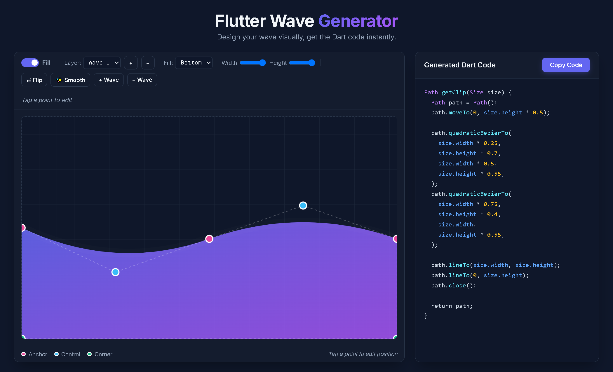

<div align="center">

# 🌊 Flutter Wave Generator `v2.0`

### *Design flutter `CustomClipper` curves visually. Zero coordinate guessing.*

[](https://flutter.dev)
[](https://dart.dev)
[](LICENSE)
[](https://github.com/ayoub99-10/flutter-wave-generator/pulls)
[](https://github.com/ayoub99-10/flutter-wave-generator/stargazers)

<br/>



<br/>

[🚀 **Try It Live on GitHub Pages**](https://ayoub99-10.github.io/flutter-wave-generator/) • [✨ **Features**](#-features) • [🕹️ **Controls**](#️-interactive-canvas-controls) • [📱 **Flutter Guide**](#-flutter-integration-guide) • [🤝 **Contributing**](#-contributing)

</div>

---

## 💡 Why Flutter Wave Generator?

Creating organic, flowing shapes and curved app bars in Flutter using `CustomClipper<Path>` and `quadraticBezierTo` usually requires endless trial-and-error: tweaking magic numbers, hot reloading, and guessing coordinate math.

**Flutter Wave Generator** fixes this completely. It gives you a sleek, visual web-based studio where you manipulate curves with interactive control points, and instantly get production-grade, responsive Flutter Dart code ready to paste into your project.

---

## 🔥 What's New in V2.0?

| Feature | Description |
| :--- | :--- |
| 🥞 **Multi-Layer Stacking** | Create and manage multiple layered waves with individual gradients for rich, depth-filled liquid UIs. |
| 📐 **Dynamic Dimension Scaling** | Adjust canvas width and height percentages on the fly with live slider controls. |
| 🎛️ **Precision Point Inspector** | Click any point to view and fine-tune its exact `X` and `Y` percentage coordinates down to the single digit. |
| ✨ **Auto-Smoothing Engine** | One-click bezier anchor balancing for silky-smooth wave transitions without kinks. |
| 🔄 **180° Direction Flip** | Instantly mirror your wave horizontally or vertically with one click. |
| 🎨 **Fill & Stroke Modes** | Toggle between filled boundary shapes and stroked wave paths with adjustable stroke thickness. |
| 🧭 **4-Way Edge Fill Engine** | Switch fill origin seamlessly between `Bottom`, `Top`, `Left`, and `Right`. |
| ⚡ **Live Interactive Code** | Edit, inspect, and copy optimized Flutter code with zero latency. |

---

## 🕹️ Interactive Canvas Controls

Master the canvas with simple gestures:

| Action | Control | How to use |
| :--- | :--- | :--- |
| **Move Point** | `Left Click + Drag` | Drag any **Anchor** (blue) or **Control** (purple) point to reshape. |
| **Move Whole Shape** | `Click Fill + Drag` | Click inside the filled color area to reposition the entire design. |
| **Add Corner Anchor** | `Double Click Edge` | Double-click any straight boundary line to add a new **Green Corner Anchor**. |
| **Convert Edge to Curve** | `Long Press Edge (0.5s)`| Hold down on any straight edge to turn it into a curved Bezier line. |
| **Delete Custom Point** | `Right Click Point` | Right-click any custom corner or edge point to remove it. |
| **Precision Edit** | `Click Point` | Select any point to reveal the top inspector bar and type exact values. |

---

## 📱 Flutter Integration Guide

### Step 1: Copy Generated Code
Design your desired wave curve in the editor and click **Copy Code**.

### Step 2: Create your `CustomClipper`
Create a new file in your Flutter project (e.g. `wave_clipper.dart`):

```dart
import 'package:flutter/material.dart';

class WaveClipper extends CustomClipper<Path> {
  @override
  Path getClip(Size size) {
    Path path = Path();
    
    // ⬇️ Paste your generated code here ⬇️
    path.moveTo(0, size.height * 0.50);
    path.quadraticBezierTo(
      size.width * 0.25, size.height * 0.70,
      size.width * 0.50, size.height * 0.55,
    );
    path.quadraticBezierTo(
      size.width * 0.75, size.height * 0.40,
      size.width * 1.00, size.height * 0.55,
    );
    path.lineTo(size.width, size.height);
    path.lineTo(0, size.height);
    path.close();
    // ⬆️ Paste your generated code here ⬆️
    
    return path;
  }

  @override
  bool shouldReclip(CustomClipper<Path> oldClipper) => false;
}
```

### Step 3: Use with `ClipPath` in your Widget Tree

```dart
import 'package:flutter/material.dart';
import 'wave_clipper.dart';

class WaveHeaderWidget extends StatelessWidget {
  const WaveHeaderWidget({super.key});

  @override
  Widget build(BuildContext context) {
    return ClipPath(
      clipper: WaveClipper(),
      child: Container(
        height: 280,
        decoration: const BoxDecoration(
          gradient: LinearGradient(
            colors: [Color(0xFF6366F1), Color(0xFFA855F7)],
            begin: Alignment.topLeft,
            end: Alignment.bottomRight,
          ),
        ),
        child: const Center(
          child: Text(
            'Flutter Wave Generator V2',
            style: TextStyle(
              color: Colors.white,
              fontSize: 24,
              fontWeight: FontWeight.bold,
            ),
          ),
        ),
      ),
    );
  }
}
```

### 🥞 Pro Tip: Multi-Layered Waves

Stack multiple clippers with differing heights, opacities, and gradients using Flutter's `Stack` widget:

```dart
Stack(
  children: [
    Opacity(
      opacity: 0.5,
      child: ClipPath(clipper: WaveBackClipper(), child: Container(height: 300, color: Colors.indigoAccent)),
    ),
    ClipPath(
      clipper: WaveFrontClipper(),
      child: Container(height: 280, color: Colors.deepPurple),
    ),
  ],
)
```

---

## 💻 Local Setup & Development

No complex toolchain, bundler, or build step required. Just pure vanilla web technologies:

```bash
# 1. Clone the repository
git clone https://github.com/ayoub99-10/flutter-wave-generator.git

# 2. Navigate to project directory
cd flutter-wave-generator

# 3. Open in any modern web browser
# (On macOS)
open index.html
# (On Windows)
start index.html
# (On Linux)
xdg-open index.html
```

Or serve locally with Python:

```bash
python -m http.server 8080
# Visit http://localhost:8080 in your browser
```

---

## 🛠️ Built With

- **HTML5 & SVG** — High-performance vector rendering and dynamic path definitions
- **CSS3 Modern Layout** — Responsive flex/grid interface with custom dark theme
- **Vanilla JavaScript (ES6+)** — Smooth math conversions, bezier spline calculations, and state management
- **Zero Dependencies** — Fast, lightweight, and framework-free

---

## 🤝 Contributing

Contributions, issues, and feature requests are welcome!

1. Fork the Project
2. Create your Feature Branch (`git checkout -b feature/AmazingFeature`)
3. Commit your Changes (`git commit -m 'Add some AmazingFeature'`)
4. Push to the Branch (`git push origin feature/AmazingFeature`)
5. Open a Pull Request

---

## ⭐ Show Your Support

If this tool saved you time crafting custom Flutter shapes, please consider giving it a **Star** ⭐! It helps the project grow and reach more developers.

---

## 📜 License

Distributed under the **MIT License**. See `LICENSE` for more information.

<div align="center">
  <sub>Created with ❤️ by <a href="https://github.com/ayoub99-10">Ayoub</a></sub>
</div>
